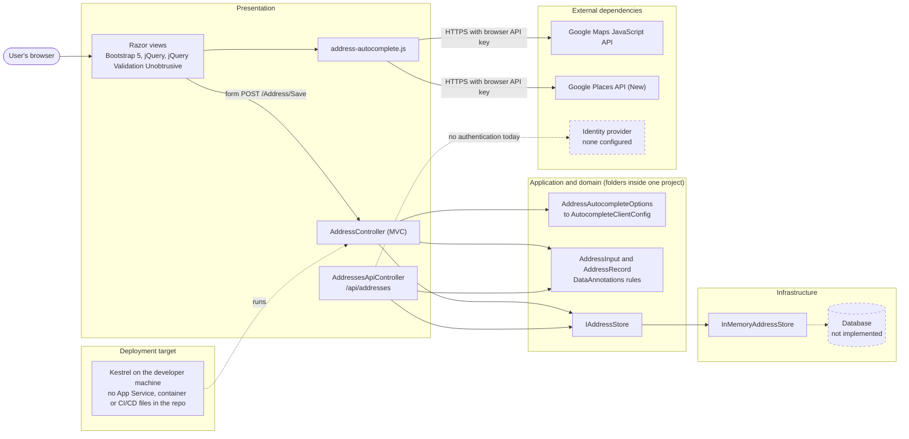
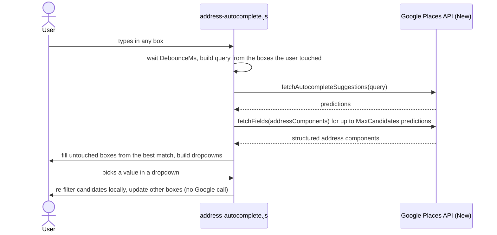
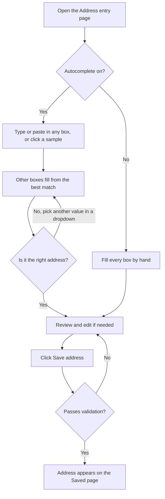

# AddressApp — Address entry form with Google Places autocomplete and per-field dropdowns

An ASP.NET Core 10 MVC and Web API sample. A user types in any one address box and the other boxes fill in
and offer dropdown choices, using Google Places from the browser. The whole feature can be switched on or off
from `appsettings*.json`.

## Who should read what

| You are | Start at |
|---------|----------|
| Developer | [3. For Application Developers](#3-for-application-developers) |
| Solution architect | [4. For Solution Architects](#4-for-solution-architects) |
| Business analyst | [5. For Business Analysts](#5-for-business-analysts) |
| Application owner | [6. For Application Owners](#6-for-application-owners) |

Everyone should read [2. Solution Overview](#2-solution-overview-all-audiences) first.

## Contents

1. [Project title and tagline](#addressapp--address-entry-form-with-google-places-autocomplete-and-per-field-dropdowns)
2. [Solution Overview](#2-solution-overview-all-audiences)
3. [For Application Developers](#3-for-application-developers)
4. [For Solution Architects](#4-for-solution-architects)
5. [For Business Analysts](#5-for-business-analysts)
6. [For Application Owners](#6-for-application-owners)
7. [License](#7-license)

> **Status of this document.** Everything below was checked against the source manifest of this project
> (26 files, created 2026-10-06 10:17) and re-checked against the source files on 2026-10-07
> (routes, defaults and limits, validation rules, security claims, library versions, anchors). Where something does not exist yet (database, authentication, tests, CI/CD, deployment files, license),
> this README says so instead of describing it as if it did.
> No build, NuGet or license badges are shown because the repository contains no CI workflow,
> no published package and no license file to verify them against.

---

## 2. Solution Overview (All Audiences)

### Business context

Typing a full postal address into seven separate boxes is slow and error-prone: people misspell street names,
guess the county or district, and mistype postal codes. AddressApp lets a user start typing in whichever box
they know best, or paste a whole address, and fills in the rest from Google's address data. Each box also
offers a dropdown of the other matching values, so a user can correct a wrong guess with one click instead of
retyping. The feature has a single switch (`AddressAutocomplete:Enabled`), so a business can turn it off
without a code change, for example to stop Google usage costs.

### Technical architecture

AddressApp is a single ASP.NET Core project (`net10.0`) with no NuGet dependencies beyond the framework.
Server-side it hosts an MVC form (`/Address`) and a small REST API (`/api/addresses`) that share one
`IAddressStore`, currently an in-memory implementation. The autocomplete runs **entirely in the browser**:
a vanilla JavaScript file loads the Google Maps JavaScript API, asks Places API (New) for up to five
candidate addresses, expands each into structured address components, and builds the per-box dropdowns
locally. The server only decides whether the feature is active and hands the browser its settings.

The code has no separate application, domain or data-access projects. Those layers are folders inside one
project, and the `IAddressStore` interface is the seam where a real database would plug in.



Dashed boxes and arrows are things that do not exist in the code today.

### Components

| Component | Responsibility | Technology |
|-----------|---------------|------------|
| MVC controller (`AddressController`) | Serves the form, validates and saves posts, lists saved addresses, error page | ASP.NET Core MVC, Razor |
| Web API controller (`AddressesApiController`) | `GET`/`POST` addresses as JSON, automatic 400 on invalid input | ASP.NET Core Web API (`[ApiController]`) |
| Settings (`AddressAutocompleteOptions`, `AutocompleteClientConfig`) | Bind `AddressAutocomplete` settings, clamp values, expose only what the browser needs | Options pattern, `System.Text.Json` |
| Domain models (`AddressInput`, `AddressRecord`) | Field rules (required, length, postal code format) shared by form and API | C# record and class, DataAnnotations |
| Store (`IAddressStore`, `InMemoryAddressStore`) | Persistence seam; demo implementation keeps data in memory | C#, `ConcurrentDictionary` |
| Autocomplete script (`address-autocomplete.js`) | Google lookups, candidate parsing, fill-in, dropdowns | Plain JavaScript (no build step), Google Maps JS API, Places API (New) |
| UI libraries (`wwwroot/lib`) | Layout, form validation messages | Bootstrap 5.3.8, jQuery 3.7.1, jQuery Validation 1.22.1, jQuery Validation Unobtrusive 4.0.0 |

---

## 3. For Application Developers

### Prerequisites

| Requirement | Detail |
|-------------|--------|
| .NET SDK | .NET 10 SDK. The project targets `net10.0`; there is no `global.json`. |
| Database | None. Data is held in memory and lost on restart. |
| Google Cloud project | Billing enabled (Google requires it even for the free allowance), with **Maps JavaScript API** and **Places API (New)** enabled. The older "Places API" is a different service and does not work with this app. |
| Google API key | A browser key restricted by HTTP referrer and by API (see [Google key setup](#google-key-setup)). |
| Browser | Any current browser; the key is called from the browser, not the server. |

Never commit a real key. Use a placeholder in documentation and scripts:

```bash
# bash
export AddressAutocomplete__GoogleMapsApiKey="<YOUR_GOOGLE_MAPS_BROWSER_KEY>"
```

```powershell
# PowerShell
$env:AddressAutocomplete__GoogleMapsApiKey = "<YOUR_GOOGLE_MAPS_BROWSER_KEY>"
```

### Build and run

There is no `.sln` file. Run these from the folder that contains `AddressApp.csproj`:

```bash
git clone [repo-url]
cd [repo-folder]/AddressApp
dotnet restore
dotnet build

# Keep the key out of source control (stored per user, outside the repo):
dotnet user-secrets set "AddressAutocomplete:GoogleMapsApiKey" "<YOUR_GOOGLE_MAPS_BROWSER_KEY>"

dotnet run
```

`dotnet run` uses the `https` launch profile, which sets `ASPNETCORE_ENVIRONMENT=Development` and serves:

| URL | Purpose |
|-----|---------|
| `https://localhost:7101` | Main URL (add it to the key's referrer list as `https://localhost:7101/*`) |
| `http://localhost:5101` | Redirects to HTTPS; also add `http://localhost:5101/*` to the referrer list |

When it works, the page shows a green **Autocomplete on** badge and four sample buttons.
To run without any Google account, leave the key empty: the badge reads **Autocomplete off** and the
form is a plain set of text boxes.

### Google key setup

1. In [Google Cloud Console](https://console.cloud.google.com), create a project and link a billing account.
2. Under APIs & Services → Library, enable **Maps JavaScript API** and **Places API (New)**.
3. Under APIs & Services → Credentials, create an API key.
4. Restrict it:
   - **Application restrictions:** Websites, with `https://localhost:7101/*` and `http://localhost:5101/*`.
   - **API restrictions:** Restrict key, selecting **Maps JavaScript API** and **Places API (New)**.
5. In Billing → Budgets & alerts, create a budget alert. Optionally lower the daily quotas.
6. Check the current free usage allowance at <https://mapsplatform.google.com/pricing/>.

The name you give the key in the console (for example `address-app-dev-Oct6-APIKey`) is only a label.
The app setting is always `GoogleMapsApiKey`; only the value is your key.

### Configuration

Settings live in the `AddressAutocomplete` section. Standard ASP.NET Core precedence applies:
`appsettings.json`, then `appsettings.{Environment}.json`, then user secrets (Development only), then environment variables.

| Setting | Type | Default in code | Meaning |
|---------|------|-----------------|---------|
| `Enabled` | bool | `false` | Master switch. Keep `false` in `appsettings.json` and set `true` in `appsettings.Development.json`. |
| `GoogleMapsApiKey` | string | empty | Browser key. **The feature is active only when `Enabled` is true and this is not blank.** Supply it through user secrets or environment variables, not a committed file. |
| `MinChars` | int | `3` | Characters (across the boxes you typed in) before a lookup starts. Clamped to 1–20. |
| `DebounceMs` | int | `500` | Pause after the last keystroke before calling Google. Clamped to 150–5000. |
| `MaxCandidates` | int | `5` | Candidate addresses behind the dropdowns. Each costs one Place Details call. Clamped to 1–10. |
| `Language` | string | none | Optional BCP-47 language for results, for example `en`. |
| `IncludedRegionCodes` | string[] | empty | Optional lowercase two-letter country codes to restrict results, for example `["us", "in"]`. |

Environment variable form uses double underscores, and array items use an index:
`AddressAutocomplete__Enabled=true`, `AddressAutocomplete__IncludedRegionCodes__0=us`.

If `Enabled` is true but the key is blank, the app logs a warning at startup and keeps the feature off.

### Using the form

- **Boxes:** Street name, Building / Apartment (house number, building name, unit), City, County / District,
  State, Postal code / PIN code, Country.
- **Type in any box.** The other boxes fill from the best match (shaded light blue). Each box has an arrow button
  and opens on focus, listing the other values the candidates offer.
- **Pick a dropdown value** to pin that box. The remaining boxes re-filter locally to matching candidates
  with no extra Google call.
- **Paste a whole address** with commas, such as `2800 Hancock Dr, Austin, TX 78731, United States`,
  into any box and it is split across all the boxes.
- **Empty a box** to hand it back to autofill; the **Clear** button resets the whole form.
- **Samples:** four buttons fill the form from the addresses used for testing (two in Schaumburg IL, Washington DC, Austin TX).

### Web API

Base path `/api/addresses`. JSON uses camelCase. No authentication is required today.

| Method | Route | Success | Errors |
|--------|-------|---------|--------|
| `GET` | `/api/addresses` | `200` list, newest first | |
| `GET` | `/api/addresses/{id}` | `200` record | `404` unknown id |
| `POST` | `/api/addresses` | `201` record and `Location` header | `400` validation problem details |

```bash
curl -k -X POST https://localhost:7101/api/addresses \
  -H "Content-Type: application/json" \
  -d '{"street":"Hancock Drive","building":"2800","city":"Austin","county":"Travis County","state":"Texas","postalCode":"78731","country":"United States"}'
```

The MVC routes are `GET /Address`, `POST /Address/Save` (antiforgery token required), `GET /Address/Saved` and `GET /Address/Error`.
The default route opens the form.

### Project layout

```text
<repo-root>/
├── README.md                          this file
├── CopyPowerShell.ps1                 helper that writes SourceCodeManifest.txt (see "Sharing the code safely")
└── AddressApp/
    ├── AddressApp.csproj                  net10.0, user-secrets id, no NuGet packages
    ├── Program.cs                         DI, middleware pipeline, route mapping, startup warning
    ├── appsettings.json                   base settings (keep autocomplete off and the key blank)
    ├── appsettings.Development.json       development settings (autocomplete on; keep the key out of this file)
    ├── Properties/launchSettings.json     https profile, ports 7101 and 5101
    ├── Controllers/
    │   ├── AddressController.cs           MVC: form, save, saved list, error
    │   └── AddressesApiController.cs      Web API: list, get, create
    ├── Models/
    │   ├── AddressInput.cs                AddressInput (validation rules) and AddressRecord
    │   └── AddressPageViewModel.cs        page model and AutocompleteClientConfig
    ├── Options/AddressAutocompleteOptions.cs
    ├── Services/IAddressStore.cs          IAddressStore and InMemoryAddressStore
    ├── Views/                             Razor: layout, Address/Index, Saved, Error
    └── wwwroot/
        ├── js/address-autocomplete.js     all client-side autocomplete logic
        ├── css/site.css                   dropdown and autofill styling
        └── lib/                           bundled Bootstrap, jQuery, validation scripts
```

### Sharing the code safely

`CopyPowerShell.ps1` (repo root) scans the current folder and writes `SourceCodeManifest.txt` containing every file's
**full content**. It skips `.git`, `.vs`, `bin`, `obj`, `node_modules`, `packages`, `logs`, `.idea` and `.vscode`, and
`.dll`, `.pdb`, `.exe`, `.log`, `.tmp` and `.cache` files, but it does **not** skip `appsettings*.json`. Any key written
in those files therefore ends up in the manifest. Keep the key in user secrets (stored outside the repo) so a manifest,
a zip or a commit never carries it, and treat a manifest as sensitive until you have checked it.

### Testing

There are no automated tests in the repository. The autocomplete script was exercised once against a mocked
Google library (debounce, fill-in, dropdown contents, pick-to-narrow, full-address split, the four sample
addresses) with hand-built data, not live Google responses. See [4. For Solution Architects](#known-limitations-and-backlog)
for the recommended test additions.

### Troubleshooting

| Symptom | Cause | Fix |
|---------|-------|-----|
| Badge says **Autocomplete off** | `Enabled` is false, the key is blank, or the app is not running in Development | Set both settings; run with `dotnet run` or set `ASPNETCORE_ENVIRONMENT=Development` |
| `dotnet user-secrets list` shows nothing | Run outside the project folder, or `<UserSecretsId>` in the `.csproj` was edited | Run in the folder with the `.csproj`; `UserSecretsId` must stay a GUID, never the key |
| Key set but still off | Setting renamed (for example to the key's console label) | The name must be exactly `GoogleMapsApiKey` |
| Status line: *Places API (New) has not been used in project … or it is disabled* | API not enabled | Enable **Places API (New)** in the Google Cloud project |
| `403`, `API_KEY_SERVICE_BLOCKED` in the browser Network tab | Key's API restriction does not include **Places API (New)** | Add it to the key's API restrictions and save |
| Status line: *Google rejected the API key* | Wrong key, billing not linked, or referrer list does not match the page URL | Check the key, billing, and that the referrer matches scheme, host and port |
| No suggestions appear | Fewer than `MinChars` characters typed, or Google found no match | Type more, or try a fuller address |
| Error page throws instead of rendering | `Error.cshtml` missing `@using AddressApp.Controllers` (fixed in this version) | Make sure the first line of `Views/Address/Error.cshtml` is `@using AddressApp.Controllers` |

---

## 4. For Solution Architects

### Lookup flow



### Key design decisions

| Decision | Rationale | Consequence |
|----------|-----------|-------------|
| Lookups run in the browser, no server proxy | Original requirement: client-side only | The key is visible to every user. Referrer and API restrictions are the only protection; there is no server-side rate limiting or audit trail |
| Several candidates, not one | Google returns one structured result per selected prediction, so one result cannot populate several dropdowns. Fetching components for up to `MaxCandidates` predictions gives each box real alternatives | One Place Details call per candidate per lookup, so cost scales with `MaxCandidates` |
| Settings read server-side, passed as a `data-` attribute | One switch for the feature; the key is only emitted when the feature is active | Disabling the feature removes the key from the page entirely |
| Custom dropdowns, not `<datalist>` | Per-box filtering by the other boxes' choices | More script to maintain; keyboard support is hand-written (arrows, Enter, Escape) |
| Pick-to-narrow is local | Avoids extra paid requests | Dropdowns only ever offer values from the candidates already fetched |
| Single project with an `IAddressStore` seam | Small sample; avoids ceremony | Layers are conventions, not compile-time boundaries |

### Non-functional view

| Area | Current state |
|------|---------------|
| Security | Antiforgery on the MVC form post; DataAnnotations validation on form and API; Google data rendered with `textContent`; HTTPS redirection in every environment, and HSTS outside Development. **No authentication or authorization, no rate limiting, no Content-Security-Policy** |
| Performance | Debounced lookups, per-query cache in browser memory, at most `MaxCandidates` detail calls per lookup |
| Scalability | Singleton in-memory store: single instance only, data lost on restart |
| Reliability | If Google fails, a status message appears and the form still works by hand |
| Observability | Default ASP.NET Core logging and one startup warning; lookups are not visible server-side because they never touch the server |
| Portability | Any ASP.NET Core host works. No Dockerfile, App Service configuration or pipeline files exist |

### Known limitations and backlog

| Item | Why it matters |
|------|----------------|
| No persistence | Replace `InMemoryAddressStore` with an EF Core implementation of `IAddressStore` |
| No authentication on the API | Anyone who can reach the site can read and write addresses |
| No tests | Add xUnit tests for validation and the API, and a JavaScript test for candidate parsing and filtering |
| No CI/CD, `.sln`, `global.json` or deployment files | Add a build-and-test workflow and pin the SDK |
| Result quality depends on Google | Street spelling and abbreviations differ (for example `Drive` instead of `Dr`); some places have no county (Washington, DC) |
| Free usage is capped by Google, not by this app | Set budget alerts and quotas in Google Cloud |
| Optional: server-side proxy | Would hide the key and allow rate limiting, at the cost of the client-side-only design |

---

## 5. For Business Analysts

### Capabilities

| # | Capability | Behavior |
|---|------------|----------|
| 1 | Address entry form | Seven boxes: street, building/apartment, city, county/district, state, postal/PIN code, country |
| 2 | Type-ahead from any box | Typing in any box fills the others from the best matching address |
| 3 | Alternative values | Every box offers a dropdown of other matching values; picking one updates the rest |
| 4 | Whole-address entry | A full address typed or pasted into one box is split across all boxes |
| 5 | Feature switch | Autocomplete can be turned on or off by configuration, with no code change |
| 6 | Save and review | Valid addresses are saved and listed; also available through a REST API |

### User flow



### Business rules

| Field | Required | Maximum length | Notes |
|-------|----------|----------------|-------|
| Street name | Yes | 200 | |
| Building / Apartment | No | 200 | Autofill combines house number, building name and unit, for example `1299, ZAIC` |
| City | Yes | 100 | |
| County / District | No | 100 | Some places have none |
| State | Yes | 100 | |
| Postal code / PIN code | No | 20 | Letters, digits, spaces and hyphens; 3–20 characters; must start and end with a letter or digit |
| Country | Yes | 100 | |

Saved addresses are kept in memory only and disappear when the application restarts.

### Acceptance scenarios

The four test addresses are below. "Expected" values describe what the logic should produce from typical Google
data; the exact wording (for example `Drive` versus `Dr`) comes from Google and can differ.

| # | Given | When | Then (expected) |
|---|-------|------|-----------------|
| 1 | Autocomplete on | The user clicks the first sample, `1299 Zurich Way ZAIC, Schaumburg, IL 60196, United States` | Street `Zurich Way`, city Schaumburg, county Cook County, state Illinois, postal code 60196, country United States |
| 2 | Autocomplete on | The user selects the sample `1551 Thoreau Dr N, Schaumburg, IL 60173, United States` | Same city, county and state; postal code 60173 |
| 3 | Autocomplete on | The user selects the sample `1600 Pennsylvania Ave NW, Washington, DC 20500, United States` | State District of Columbia, postal code 20500, county left empty |
| 4 | Autocomplete on | The user selects the sample `2800 Hancock Dr, Austin, TX 78731, United States` | City Austin, county Travis County, state Texas, postal code 78731 |
| 5 | Scenario 1 completed and Google returned a second Schaumburg candidate | The user opens the postal code dropdown and picks `60173` | Street, building and the other boxes switch to the matching candidate. If Google returned only one candidate, the dropdown offers only one value |
| 6 | Autocomplete off | The user opens the page | The badge reads "Autocomplete off", no samples, all boxes typed by hand |
| 7 | Any state | The user leaves Street, City, State or Country empty and saves | The form shows the matching "is required" message and nothing is saved |

### Out of scope

User accounts and permissions, address verification or delivery checks, permanent storage, bulk import, and maps.

### Glossary

| Term | Meaning |
|------|---------|
| County / District | Administrative area below the state (a county in the US, a district in India) |
| Postal code / PIN code | ZIP code (US), PIN code (India), postcode (UK) |
| Candidate | One possible address returned by Google for what the user typed |
| Pinned box | A box the user typed in or picked from, which autofill will not overwrite |

---

## 6. For Application Owners

### At a glance

| Question | Answer |
|----------|--------|
| What does it do? | Speeds up and corrects address entry using Google address data |
| Is it production-ready? | **No.** It is a working sample: in-memory storage, no sign-in, no tests, no pipeline |
| Does it cost money? | The app itself does not. Each lookup calls paid Google services (Maps JavaScript and Places API (New)) within Google's free monthly allowance, which you must check and cap |
| Can it be turned off quickly? | Yes. Set `AddressAutocomplete:Enabled` to `false`. The form keeps working with manual entry |
| Where is customer data kept? | In server memory only, until the app restarts. What users type is also sent to Google as search text |
| Who is the owner? | [Product owner: name and contact] / [Technical owner: name and contact] |

### Cost and key controls

- Create a **budget alert** in Google Cloud Billing and consider lowering daily quotas for the Places API.
- Keep `MaxCandidates` low (default 5). Cost per lookup grows with it. Raising `DebounceMs` or `MinChars` also reduces calls.
- Restrict the key to your site's addresses and to the two APIs it needs. Anyone who sees the page can see the key.
- Rotate the key if it is ever pasted into a ticket, chat, screenshot or commit. Create a new restricted key and delete the old one.
- Never put a real key in `appsettings.json`. Use user secrets locally and your host's secret store or environment variables elsewhere.
- **Status at the 2026-10-06 snapshot:** both `appsettings.json` (with `Enabled` set to `true`) and `appsettings.Development.json` contained a real key value. Remove the key from both files, set the base file back to `Enabled: false`, and rotate the key, because it has also been exposed in the manifest and in chat.

### Operations

| Task | How |
|------|-----|
| Turn autocomplete off | Set `AddressAutocomplete:Enabled` to `false` (settings files are normally reloaded; restart if your host does not) |
| Check it is active | The page shows a green **Autocomplete on** badge |
| Diagnose problems | Use the [Troubleshooting](#troubleshooting) table |
| Privacy review | Disclose that address text is sent to Google while a user types |

### Readiness checklist before real use

- [ ] Replace in-memory storage with a database
- [ ] Add authentication and authorization
- [ ] Restrict and budget-cap the Google key
- [ ] Make sure the shipped `appsettings.json` has `Enabled` set to `false` and no key (not yet true at the 2026-10-06 snapshot)
- [ ] Add automated tests and a CI/CD pipeline
- [ ] Add hosting and deployment configuration
- [ ] Agree privacy wording and Google terms of use with your legal team
- [ ] Add a license file

---

## 7. License

No license file was found in the repository. Add one (for example `LICENSE`) before sharing or open-sourcing the code.
Bundled third-party libraries keep their own licenses: Bootstrap, jQuery and jQuery Validation are MIT-licensed;
jQuery Validation Unobtrusive is distributed under Microsoft's own license terms (see its package). Use of Google Maps Platform is subject to Google's terms.
